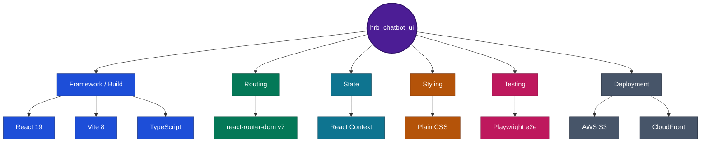

# HRB Chatbot UI

React + TypeScript + Vite frontend for `hrb_chatbot_service` (a separate repo,
deliberately - see
[`07-reactjs-ui.html`](https://github.com/rvsree/hrb_chatbot_service/blob/master/docs/dev-reference/hrb_chatbot_v3/deployment-and-ops/deployment-guide/07-reactjs-ui.html)
in the `hrb_chatbot_service` repo).
Deploys to S3 + CloudFront, not App Runner - its own build/deploy pipeline,
decoupled from the backend's.

## Live demo

**[hrb-chatbot-ui.rvsree.dev](https://hrb-chatbot-ui.rvsree.dev)** - log in as any
persona from `hrb_chatbot_service/docs/agent-reference/KNOWN-PERSONAS.md`
(e.g. `EMP052` / Eddy Employee / employee), then ask a benefits question, check
a leave balance, or file an unpaid-leave request to see the HITL workflow end
to end. Backend App Runner services (`hrb_chatbot_service`,
`hrb_api_gateway_service`, `hrb_lms_mcp`) pause by default for cost control -
if the first request hangs rather than failing outright, they're spinning
back up (~30-60s cold start), not broken; see the platform's own
`PLATFORM-HANDOFF.md` for the pause/resume script.

### Viewing the architecture docs

This repo's `.html`/`.drawio` architecture docs (and the shared ones in
`hrb_emp_assist`) **render correctly only through the live Admin
Dashboard's docs viewer, or opened directly in a browser/draw.io** -
GitHub's own file preview always shows these as raw source text, never a
rendered page (GitHub forces `Content-Type: text/plain` on every raw
file, including `.html`, as an anti-XSS measure - not a bug in this
project). To see them rendered: log in to the live demo's Admin
Dashboard as `ADM001` and open the **Architecture Docs** tab, or clone
the repo and open the file locally.

## Tech Stack



No state-management library (Redux/Zustand) or HTTP client library (axios) -
just React Context (`src/context/IdentityContext.tsx`) and the native
`fetch` API. No CSS framework either - plain `.css` files
(`src/App.css`, `src/index.css`).

## What this repo demonstrates

- **Full explainability UI** - every answer's citations, retrieval sources,
  token usage, latency breakdown, and live groundedness verdict are
  rendered, not just the chat text.
- **Admin surface** beyond the chat itself: conversations, feedback, HITL
  leave-approvals, live-query/synthetic-dataset viewers, CI/CD pipeline
  status, and a runtime Settings page - all against the live backend APIs,
  Redis-cached (24h TTL, manual Refresh) for fast tab switches.
- **End-to-end HITL workflow UI** - the unpaid-leave request/approval
  flow, not just a chat transcript.
- **Cut over to the API Gateway** (2026-10-23), not calling the
  backend directly - CORS/RBAC/rate-limiting all flow through one entry
  point, confirmed working live.
- **Playwright e2e coverage** (`e2e/`) against the real deployed stack, not
  just unit tests against mocks.

## Diagrams and cross-service docs

These live in the shared `hrb_emp_assist` repo, not duplicated here - see
["Viewing the architecture docs"](#viewing-the-architecture-docs) above
for why GitHub shows them as raw source rather than rendering them.

[Current state architecture](https://github.com/rvsree/hrb_emp_assist/blob/master/docs/architecture/diagrams/hrb-chatbot-ui-current-state-architecture.drawio)
(editable `.drawio`) - the 12 pages and the one API client they share.
No target-state or `.drawio` deployment diagram exists for this repo yet -
a static SPA behind CloudFront doesn't have the same scaling story the
backend services do; see the
[build process](https://github.com/rvsree/hrb_emp_assist/blob/master/docs/deployment-and-ops/build-and-deploy/01a-hrb-chatbot-ui-build-process.html)
and
[deployment architecture](https://github.com/rvsree/hrb_emp_assist/blob/master/docs/deployment-and-ops/build-and-deploy/01b-hrb-chatbot-ui-deployment-architecture.html)
HTML docs instead. For the cross-service picture, start at
[`platform-overview.html`](https://github.com/rvsree/hrb_emp_assist/blob/master/docs/architecture/platform-overview.html).

## Environments

| App | Local | AWS (production) |
| --- | --- | --- |
| Frontend (this repo) | `http://localhost:5173` (`npm run dev`) | `https://hrb-chatbot-ui.rvsree.dev` |
| Gateway (`hrb_api_gateway_service`, separate repo - what this frontend actually calls in production as of 2026-10-23) | `http://127.0.0.1:8100` | `https://necxf9n7mv.us-east-1.awsapprunner.com` |
| Backend (`hrb_chatbot_service`, separate repo) | `http://127.0.0.1:8093` | `https://hrb-chatbot.rvsree.dev` |
| MCP server (`hrb_lms_mcp`, separate repo - leave balance/history tools, called by the backend, not by this frontend directly) | `http://127.0.0.1:8190` | `https://hrb-lms-mcp.rvsree.dev` |

Local dev (`.env`, gitignored) points at whatever `VITE_API_BASE_URL` you
set - `.env.example` defaults it to the production backend, so a fresh
`cp .env.example .env` works with no editing. The production build
(`.env.production`, committed - no secrets in it) targets
`hrb_api_gateway_service` (`https://necxf9n7mv.us-east-1.awsapprunner.com`),
not the backend directly - **2026-10-23 cutover**: this repo's own traffic
now goes through the Gateway, matching the system's intended architecture
(single public entry point for RBAC/CORS/rate-limiting). The Gateway's own
CORS allow-list and `/health` response shape were already built (Phases
1/7) specifically for this origin and this frontend's dual-shape
`getHealth()` reader - confirmed working live, not just configured.

The AWS frontend is a static `npm run build` output synced to an S3 bucket
(`hrb-chatbot-ui-rvsree`) behind a CloudFront distribution with a Route53
alias - provisioned manually via the AWS CLI (2026-10-07), sitting unused
until **2026-10-23**, when a fresh build was pushed live and a CI/CD
pipeline (`.github/workflows/deploy.yml`, a scoped
`hrb-chatbot-ui-github-actions-deploy` IAM user) was wired up - every push
to `master` now rebuilds, syncs to S3, and invalidates CloudFront
automatically, the same "no manual deploy step" convention the other 6
repos already use.

## Running this project (first time, step by step)

If you're coming from ASP.NET: there's no single "project file" to open or
run. You run small commands in a terminal, and they read config files
automatically - closer to running `dotnet watch run` from a terminal than
pressing F5 in Visual Studio.

1. **Open a terminal in VS Code.** Menu bar -> Terminal -> New Terminal (or
   `` Ctrl+` ``). Make sure it's sitting in this project's folder (the
   prompt should show `hrb_chatbot_ui`).
2. **Install dependencies (first time only, like `dotnet restore`):**
   ```
   npm install
   ```
   This reads `package.json` (closest equivalent: a `.csproj` plus its
   NuGet package list, combined) and downloads everything into
   `node_modules/` (gitignored, like a `bin/`/`obj/` folder - never commit
   it, never worry about its contents).
3. **Create your local config (first time only, like copying
   `appsettings.json` to `appsettings.Development.json`):**
   ```
   cp .env.example .env
   ```
   `.env` isn't committed to git - it's your machine's own settings. The
   default already points at the live AWS backend, so this works with no
   editing.
4. **Start the dev server:**
   ```
   npm run dev
   ```
   This is the closest thing to pressing F5: it starts a local web server
   and keeps running in that terminal (like IIS Express staying open while
   you debug). It prints a URL - something like `http://localhost:5173/`.
5. **Open that URL in Chrome.** That's the app. Every time you save a
   file, the open page updates itself automatically (no restart needed -
   this is "hot reload", there's no real equivalent in classic ASP.NET).
6. **To stop it:** click into that terminal and press `Ctrl+C`.

**If `npm run dev` says the port is already in use:** something else
(maybe a previous run that didn't get stopped cleanly) is still listening
on 5173. Close that old terminal, or just use a different port:
`npm run dev -- --port 5174` and open that port instead.

**What each file actually is**, mapped to ASP.NET terms:

| This project | Closest ASP.NET equivalent |
| --- | --- |
| `package.json` | `.csproj` + NuGet package list, combined |
| `package.json`'s `"scripts"` section | the commands `npm run <name>` actually runs - e.g. `npm run dev` runs `vite` |
| `vite.config.ts` | dev-server/startup config (port, plugins) |
| `tsconfig.json` | compiler settings (target framework, language version) |
| `.env` | `appsettings.Development.json` |
| `src/main.tsx` | `Program.cs` - the entry point |
| `src/App.tsx` | where routes are registered - `Startup.cs`'s `UseEndpoints` |
| `node_modules/` | `bin/`/`obj/` - generated, gitignored, ignore it |

**When something breaks in the browser:** open Chrome DevTools (`F12`),
click the **Console** tab, and either screenshot it or copy the red error
text - that's the most useful thing to paste back for help, more useful
than describing what the screen looked like.

## What's real vs. mocked

Built against `hrb_chatbot_service`'s actual API contracts, not invented ones -
see that repo's
[`ui-wireframes-review.html`](https://github.com/rvsree/hrb_chatbot_service/blob/master/docs/dev-reference/_archive/ui-wireframes-review.html)
for the original audit (archived 2026-10-23 - pre-build material, not
stale information, kept for the historical record). Updated 2026-10-07 - two of
the three gaps that audit found have since been closed:

- **Login** validates `employee_id`/`full_name`/`role` against a small
  fixed roster on the backend (`POST /v1/auth/login`, Phase 106) - denies
  an unknown identity instead of accepting anything typed into the form.
  Still not real OAuth/JWT - once signed in, role is self-asserted on
  every later request, same as before.
- **Conversation history** is real now: `GET /v1/conversations` (own list)
  and `GET /v1/conversations/{id}` (one conversation's turns) both exist
  (Phase 116) - `ChatPage.tsx` lazy-loads from these on login and merges
  them into local state, not `localStorage`-only anymore.
- **Feedback** ("Helpful"/"Not quite") is persisted for real
  (`POST`/`GET /v1/feedback`, Phase 104) - `ViewFeedbackPage.tsx` (route
  `/feedback`) lists it back out. The **explainability** popup's
  cost-in-dollars field is still the one gap left - token/latency/
  cache-vs-live/eval-score fields are all real, cost is explicitly
  excluded (tracked in `hrb_chatbot_service`'s own `BACKLOG.md`).

Real and working: asking a question (`POST /v1/genai-rag-retrieval/query`),
citations, and document upload for `hr_support`-role users
(`POST /v1/genai-rag/ingest-document/documents`).
